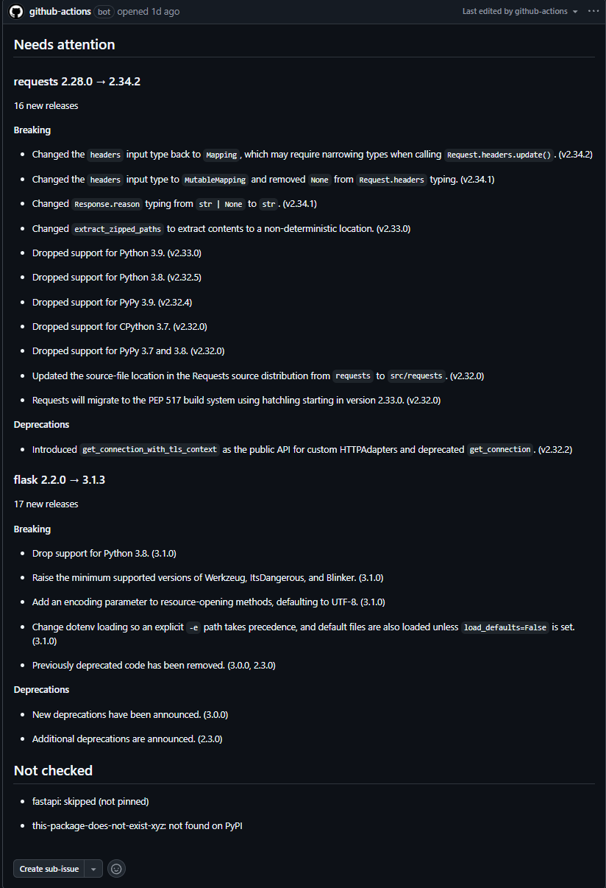
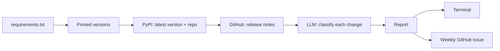

# Release Radar

Weekly check of a project's pinned Python dependencies: finds new releases, reads their release notes, and uses an LLM to flag the changes that could break your code. One GitHub issue a week instead of a dozen ignored notifications.



## Why

Keeping dependencies up to date is easy to automate, but knowing what an update will break is not. Going from flask 2.2.0 to 3.1.3 means reading 17 release notes, and the one line that matters ("Drop support for Python 3.8") is easy to miss between bug fixes. Release Radar reads them for you and lists only the breaking changes and deprecations, with the version each one came in.

## How it works



- Only exact pins (`==`) are checked. Ranges are skipped on purpose (v1 scope).
- Each change is classified as breaking, deprecation, feature, fix or other, with structured output validated by Pydantic.
- Release notes are treated as untrusted input: the prompt says so, and the output is restricted to a fixed schema.
- The weekly issue is idempotent: a second run in the same week updates the issue instead of creating a new one.

## Quick start

```bash
uv sync
cp .env.example .env    # add OPENAI_API_KEY and OPENAI_MODEL
uv run python -m release_radar example-requirements.txt
```

Post the report as a GitHub issue (needs `GITHUB_TOKEN` with issue write access):

```bash
uv run python -m release_radar requirements.txt --publish OWNER/REPO
```

## Run it every week

`.github/workflows/weekly.yml` runs every Monday at 15:17 UTC and can be started manually from the Actions tab. It needs one repository secret, `OPENAI_API_KEY`. The GitHub token is provided automatically, with only `issues: write` permission.

## Does it work? (evaluation)

A hand-labelled dataset of TODO (you) real releases from flask, httpx, requests and pydantic (`evals/dataset.csv`), checking one question: does this release contain a breaking change?

| Metric | Result |
|---|---|
| Precision | 100% (8 caught, 0 false alarms) |
| Recall | 89% (8 of 9 found) |

Single run with `gpt-6-luna`, October 2026. Run it yourself with `uv run python evals/run_eval.py`.

The first eval run found an inconsistency: my labels counted changed behavior and dropped Python versions as breaking, but the prompt's definition of "breaking" didn't. I fixed the prompt, not the labels. One miss remains: requests v2.34.0, where bug fixes change existing behavior (proxy matching, leading slashes in URLs) and the model classifies them as fixes. I kept that label, because changing labels to raise the score would make the eval meaningless, and documented it as a known limitation. With only 28 examples, these numbers are a sanity check, not a benchmark.

## Limitations

- **Run-to-run variance:** the same release can get 9 or 10 breaking changes on different runs.
- **Vague release notes give vague entries:** "New deprecations are announced." is passed through as-is.
- **One failed AI call stops the whole run** (no per-package error handling yet).
- Only the first 30 GitHub releases and the first 100 open issues are read (no pagination).
- Only PyPI packages with a GitHub repository.

## Cost

About $0.16 per weekly run with gpt-6-luna for the example requirements (about 30 AI calls). Cost grows with the number of new releases, not the number of dependencies.

## Development

```bash
uv run pytest
```

64 tests (parsing, version logic, API calls against fake servers, report formatting, and the classifier with a fake LLM). CI runs them on every pull request.

## What I'd do next

- **Keep going when one package fails.** Today one slow AI call stops the whole report; a failed package should be listed as "not checked" instead.
- **Only show changes that affect your code.** Search the project for the APIs a breaking change mentions, and put those at the top.
- **Measure the variance.** Run the eval several times, and test a stricter prompt that drops vague entries like "New deprecations are announced.